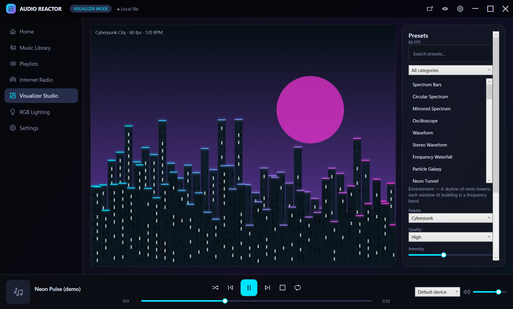
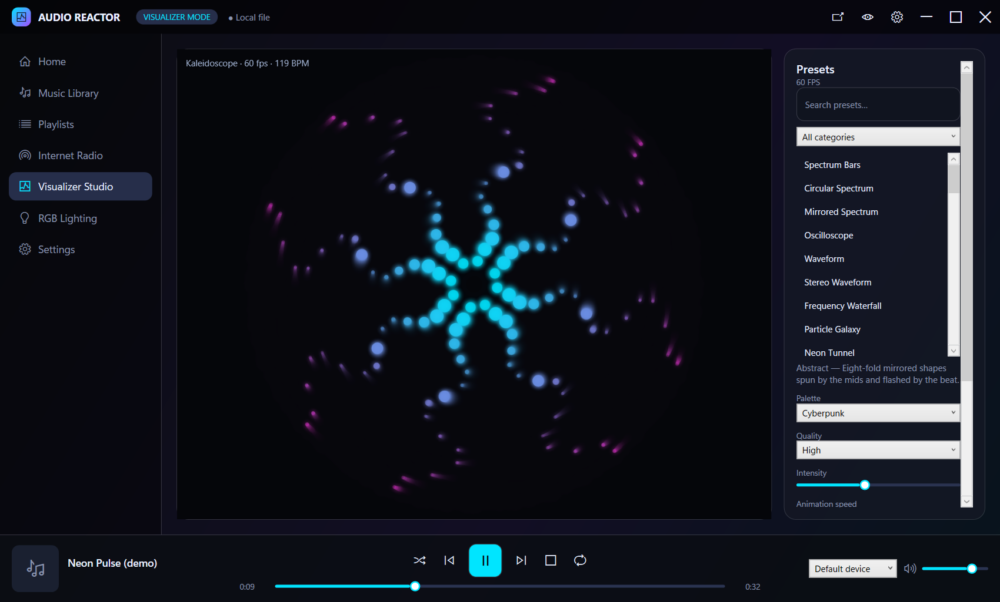
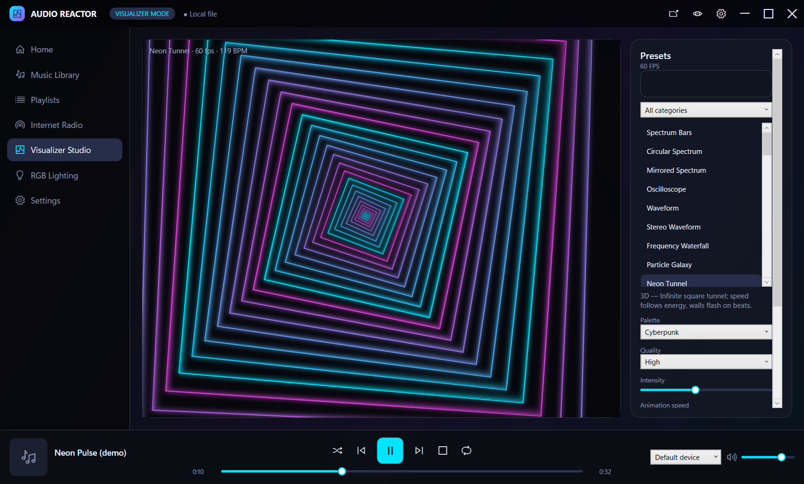
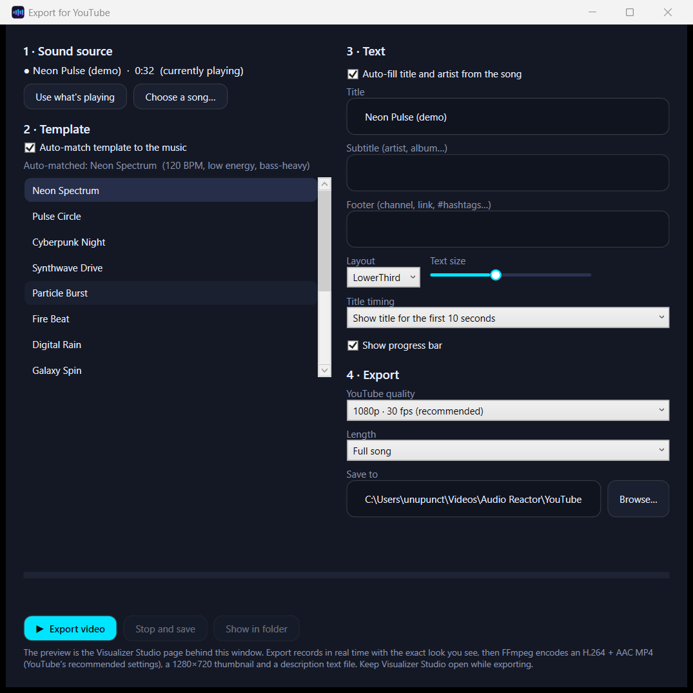
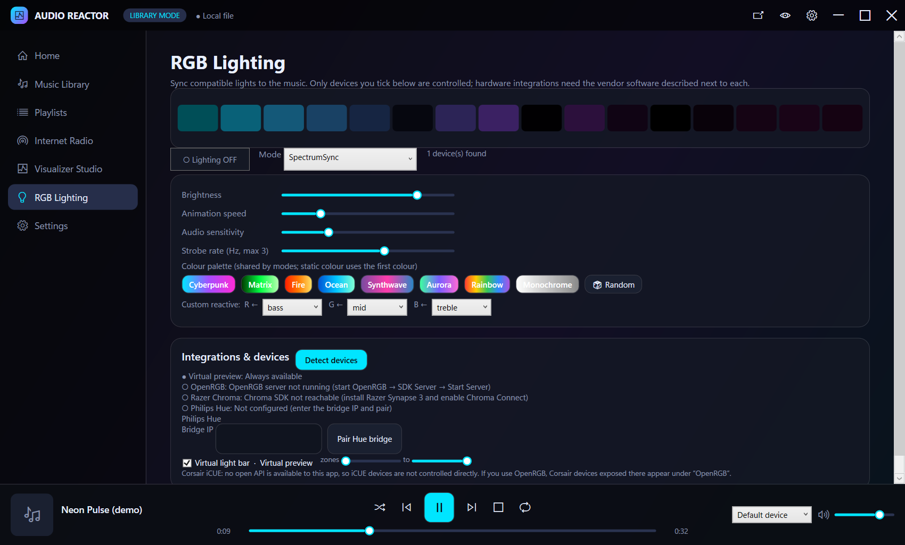

# Audio Reactor

**A Windows music player, internet radio and real-time audio-reactive visualizer — with RGB light sync and one-click YouTube video export.**

Play your music or a radio stream, watch 51 visual presets react to the actual audio, sync compatible RGB lights, and turn any song into a YouTube-ready video with an auto-matched template and your own title text.



| | |
|---|---|
|  |  |
|  |  |

## Features

**Music player** — MP3, WAV, FLAC, OGG, M4A, WMA (via the Windows decoders / Vorbis). Library with tags and artwork, search, sort, favorites, recently added / played / most played, playlists (create, rename, reorder, import/export M3U), smart playlists (genre, artist, frequently played…), queue, shuffle and repeat, drag and drop, playback speed, 10-band equalizer with presets, output-device selection with automatic recovery when a device disappears.

**Internet radio** — add your own stations (nothing is hard-coded), import `.m3u` / `.pls`, Icecast and SHOUTcast streams with now-playing metadata, configurable buffer, automatic reconnect, favorites and recently played. AAC / HLS streams fall back to the Windows media decoder.

**Visualizer engine** — FFT analysis (bass, low-mid, mid, high-mid, treble, energy, volume), real-time beat and BPM detection, and **51 presets** across Classic, 3D, Particles, Abstract and Environment. Every preset is driven by the live audio. 11 colour palettes, quality levels Low → Ultra, frame-rate limit, fullscreen on a second monitor, effect & palette editor, custom presets you can import and export.

**RGB lighting** — 10 modes (Bass Pulse, Spectrum Sync, Rainbow Flow, Beat Flash, Color Wave, Ambient Glow, Music Mood, Strobe, Static, Custom Reactive), palettes, per-device zone ranges, adapters for **OpenRGB**, **Razer Chroma** and **Philips Hue**, plus an on-screen virtual light bar. Strobe is capped at 3 flashes per second.

**Audio effects** — bass boost, treble enhancement, reverb, echo, stereo width, compressor, limiter, volume normalization (all optional, with a bypass).

**Recording & YouTube export** — record the visualizer + audio to MP4, or audio to WAV/MP3, at 720p–4K. The **Export for YouTube** assistant lets you:

1. pick the **sound source** — whatever is playing now, or choose a song;
2. **auto-match a template** to the music (the song is analysed for tempo, energy and bass/treble balance) or pick one of 12 templates;
3. **edit the text** — title, subtitle, footer, layout, size, timing, progress bar;
4. **export** an H.264 + AAC MP4 with YouTube's recommended settings, plus a 1280×720 thumbnail and a ready-to-paste description file.

**Also** — mini player, system tray with Windows notifications, start with Windows, restore the last track, structured logs.

## Install

Download **`AudioReactor-Setup.exe`** from the [latest release](https://github.com/unupunct/Audio-Reactor/releases/latest) and run it. It installs for the current user (no administrator rights), adds a Start Menu shortcut and an optional desktop shortcut, and upgrades in place — your settings and library are kept.

Requirements: Windows 10 or 11 (x64) and the Microsoft Edge WebView2 Runtime (built into Windows 11; the installer checks for it). See [INSTALLATION.md](Documentation/INSTALLATION.md).

## Documentation

- [User guide](Documentation/USER_GUIDE.md)
- [Installation](Documentation/INSTALLATION.md)
- [Troubleshooting](Documentation/TROUBLESHOOTING.md)
- [Third-party notices](THIRD-PARTY-NOTICES.md)

## What is verified — and what is not

Every claim below was tested on one Windows 11 machine. Nothing here was tested on a clean virtual machine other than as noted.

| Area | Status |
|---|---|
| Audio analysis (FFT, bands, beat/BPM) | ✅ Automated tests; a 120 BPM test track is detected as 120.0 BPM |
| Format decoding (MP3, FLAC, OGG, M4A, WMA, WAV) | ✅ Automated tests decode each format. Raw `.aac` (ADTS) plays but its duration is only an estimate |
| Playback, EQ, effects, speed | ✅ Automated tests + played on the real audio device |
| 51 visualizer presets | ✅ All run without errors and visibly react to audio (automated); several viewed live |
| Internet radio (Icecast/SHOUTcast protocol, metadata, reconnect) | ✅ Tested against a **local** Icecast-style test server. ⚠️ **Not yet tested against live internet stations**; AAC/HLS streams (Windows decoder fallback) are untested |
| Recording and YouTube export | ✅ MP4 (H.264 High + AAC 48 kHz) produced and inspected; thumbnail and description generated |
| Installer | ✅ Built and install/uninstall tested on the development machine (see release notes). ⚠️ Not tested on a clean VM |
| **Philips Hue, Razer Chroma, OpenRGB hardware** | ⚠️ **Untested on real hardware.** The lighting engine and the wire protocols are unit-tested against mock servers only |
| Corsair iCUE | ❌ No direct support (no open API). Corsair devices that OpenRGB exposes can be used through OpenRGB |

### Not implemented yet

Crossfade and gapless playback · a free-floating "desktop mode" visualizer window and screen-saver mode · compact player mode (the mini player is available) · per-frequency routing editor and bloom in the effect editor · GPU/WebGL 3D scenes (the "3D" presets are software-projected canvas effects) · output sample-rate / capture-device / channel configuration (playback device and latency are configurable) · CPU/GPU meters in the UI (the FPS counter is shown) · radio category browser and station logos fetched from the web (logo URLs you enter are shown).

## Build from source

Requirements: Windows 10/11, .NET 10 SDK. For recording/export you also need `ffmpeg.exe` (LGPL build) — run `Tools\fetch-ffmpeg.ps1`, which downloads it and verifies the archive hash.

```powershell
dotnet build Source\AudioReactor.sln
dotnet test  Source\AudioReactor.sln          # 65 tests
node Tools\test-presets.js                    # headless test of all 51 presets
dotnet run --project Source\AudioReactor.App
```

Build the installer (needs the local WiX v5 tool and its two extensions):

```powershell
dotnet tool restore
dotnet wix extension add WixToolset.UI.wixext/5.0.2
dotnet wix extension add WixToolset.BootstrapperApplications.wixext/5.0.2
Tools\fetch-ffmpeg.ps1                        # once, to bundle ffmpeg.exe
Tools\build-installer.ps1 -Version 1.0.0      # -> Installer\AudioReactor-Setup.exe and AudioReactor.msi
```

```
Source/
  AudioReactor.Core/   audio engine, FFT + beat detection, effects, radio, lighting adapters, database, recording, templates
  AudioReactor.App/    WPF app (MVVM-style services + views), WebView2 visualizer (Visualizer/*.js)
  AudioReactor.Tests/  xUnit tests
Installer/             WiX v5 package + bundle
Tools/                 icon, demo track, FFmpeg fetch, installer build, preset test, window-capture scripts
Documentation/         guides and screenshots
```

## Legal

Audio Reactor is [MIT licensed](LICENSE). It bundles FFmpeg (LGPL v3, unmodified, run as a separate process) — see [THIRD-PARTY-NOTICES.md](THIRD-PARTY-NOTICES.md). Only publish videos made from music you own or have permission to use; YouTube may block or claim videos that use copyrighted recordings. The demo track in `Demo/` is synthesized by `Tools/make_demo_track.py` and is free to use.
